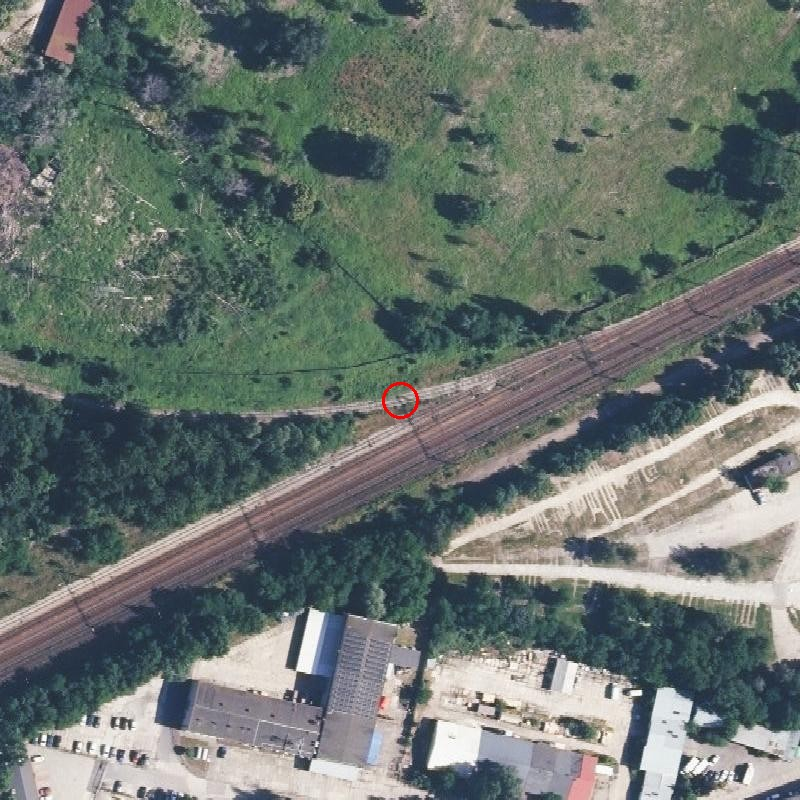

# 4. Bolesława Krzywoustego - linie 143, 292 (T1-0030)

**Wynik ryzyka: 62,3 / 100** (miejsce 4 z 20; punkt T1-0030 ma pozycję 5 z 82 kandydatów)

- Położenie: najbliższa ulica Bolesława Krzywoustego (242 m), stacja Wrocław Sołtysowice (501 m), linie 143, 292. Współrzędne 51.14083, 17.07691.
- Geoportal (ortofotomapa): https://mapy.geoportal.gov.pl/imap/Imgp_2.html?gpmap=gp0&bbox=365362,365394,365662,365694&variant=ORTOFOTOMAPA
- Ortofoto 300 x 300 m (czerwone kółko = kandydat): 

## Trzy czynniki

| czynnik | wartość 0-1 | co to znaczy |
|---|---|---|
| Ekspozycja (ilu ludzi ma powód przejść) | 0,57 | 1 707 mieszkańców w 500 m (strona A: 512, strona B: 1 195). Cele po stronie A: przystanek lub stacja, szkoła lub przedszkole, sklepy, zakłady pracy, biura, ogródki działkowe, zabudowa mieszkaniowa. Cele po stronie B: przystanek lub stacja, sklepy, zakłady pracy, biura, obiekty sportowe, zabudowa mieszkaniowa. |
| Objazd (brak legalnej drogi) | 0,50 | legalna droga 1,9 km zamiast 70 m na skróty (objazd 1,9 km, 27,8 razy dłużej); najbliższe legalne przejście: przejazd lub przejście w poziomie torów. |
| Zagrożenie (pociągi, prędkość, tory) | 0,85 | 154 pociągów pasażerskich na dobę (środa 18.11.2026, wszystkie linie w 30 m), prędkość maks. 100 km/h, torów do przejścia: 6. |

## Uwagi

- stacja lub grupa torów (5+ torów); czynnik objazdu ograniczony do 0,5, bo objazd liczony przez cały węzeł jest mniej pewny

## Zalecana interwencja

- Etap 0 (od zaraz): patrol SOK 18-23 + pomiar ruchu przed/po. Patrol zostaje do czasu wykonania rozwiązania głównego.
- Główna: **Kładka dla pieszych** - 3 500 000-11 000 000 zł/obiekt.
- Wspierająca: Ogrodzenie standardowe odcinka (siatka/panel 1,5-2 m) - 26 000-134 000 zł (założenie: 2 x 100 m ogrodzenia kanalizującego (Clapperton: min. 100 m)).
- Zawsze dodatkowo: tablice z informacją o mandacie (600-4 000 zł) (reguła R0).
- Reguła doboru: R3/R4. Ponad 3 tory lub prędkość > 160 km/h: przejście w poziomie szyn wymagałoby systemu przejazdowego (§ 11 ust. 2), więc najtańsze rozwiązanie bez niego to kładka lub tunel; alternatywa: kat. E z systemem przejazdowym (koszt nieustalony).

Stabilność: miejsce zostaje w top-20 w 100% wariantów jednej zmiany (+-50%) i w 98% z 2000 losowań wszystkich wag naraz.

Źródła: kandydat OSM (shared_node); ruch i prędkość PKP PLK (Regulamin sieci 2025/2026, zał. 2.1; rozkład PolishTrainsGTFS); ludność GUS NSP 2021 (siatka 250 m); cele i sieć piesza OpenStreetMap; ortofoto Geoportal (GUGiK). Ortofoto: pobrane z Geoportalu (WMS ORTO, StandardResolution).
