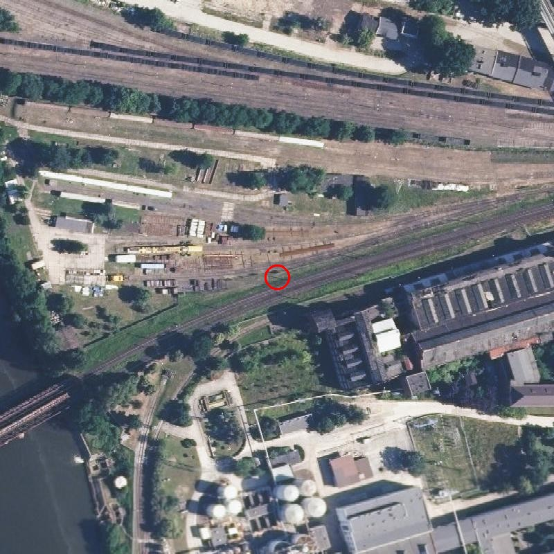

# 7. Kleczkowska - linia 143 (T1-0037)

**Wynik ryzyka: 60,9 / 100** (miejsce 7 z 20; punkt T1-0037 ma pozycję 8 z 82 kandydatów)

- Położenie: najbliższa ulica Kleczkowska (247 m), stacja Wrocław Szczepin (677 m), linia 143. Współrzędne 51.12592, 17.02269.
- To samo miejsce (w promieniu 300 m): T1-0038.
- Geoportal (ortofotomapa): https://mapy.geoportal.gov.pl/imap/Imgp_2.html?gpmap=gp0&bbox=361526,363836,361826,364136&variant=ORTOFOTOMAPA
- Ortofoto 300 x 300 m (czerwone kółko = kandydat): 

## Trzy czynniki

| czynnik | wartość 0-1 | co to znaczy |
|---|---|---|
| Ekspozycja (ilu ludzi ma powód przejść) | 0,60 | 2 474 mieszkańców w 500 m (strona A: 726, strona B: 1 748). Cele po stronie A: przystanek lub stacja, sklepy, zakłady pracy, biura, obiekty sportowe, zabudowa mieszkaniowa. Cele po stronie B: szkoła lub przedszkole, sklepy, zakłady pracy, biura. |
| Objazd (brak legalnej drogi) | 0,50 | legalna droga 3,5 km zamiast 90 m na skróty (objazd 3,4 km, 39,3 razy dłużej); najbliższe legalne przejście: wiadukt, tunel lub kładka. |
| Zagrożenie (pociągi, prędkość, tory) | 0,75 | 146 pociągów pasażerskich na dobę (środa 18.11.2026, wszystkie linie w 30 m), prędkość maks. 60 km/h, torów do przejścia: 10. |

## Uwagi

- stacja lub grupa torów (5+ torów); czynnik objazdu ograniczony do 0,5, bo objazd liczony przez cały węzeł jest mniej pewny
- inne dzikie przejścia w promieniu 300 m: po zamknięciu jednego ruch może się przesunąć

## Zalecana interwencja

- Etap 0 (od zaraz): patrol SOK 18-23 + pomiar ruchu przed/po. Patrol zostaje do czasu wykonania rozwiązania głównego.
- Główna: **Kładka dla pieszych** - 3 500 000-11 000 000 zł/obiekt.
- Wspierająca: Ogrodzenie standardowe odcinka (siatka/panel 1,5-2 m) - 26 000-134 000 zł (założenie: 2 x 100 m ogrodzenia kanalizującego (Clapperton: min. 100 m)).
- Zawsze dodatkowo: tablice z informacją o mandacie (600-4 000 zł) (reguła R0).
- Reguła doboru: R3/R4. Ponad 3 tory lub prędkość > 160 km/h: przejście w poziomie szyn wymagałoby systemu przejazdowego (§ 11 ust. 2), więc najtańsze rozwiązanie bez niego to kładka lub tunel; alternatywa: kat. E z systemem przejazdowym (koszt nieustalony).

Stabilność: miejsce zostaje w top-20 w 100% wariantów jednej zmiany (+-50%) i w 99% z 2000 losowań wszystkich wag naraz.

Źródła: kandydat OSM (shared_node); ruch i prędkość PKP PLK (Regulamin sieci 2025/2026, zał. 2.1; rozkład PolishTrainsGTFS); ludność GUS NSP 2021 (siatka 250 m); cele i sieć piesza OpenStreetMap; ortofoto Geoportal (GUGiK). Ortofoto: pobrane z Geoportalu (WMS ORTO, StandardResolution).
