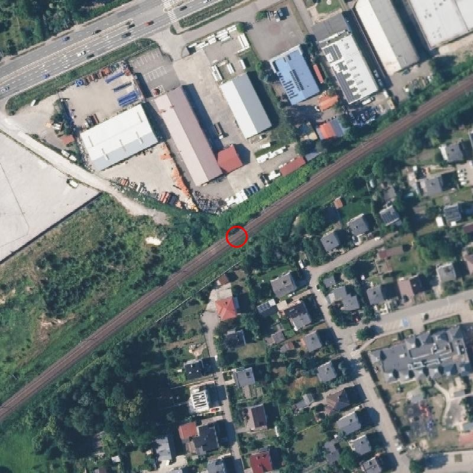

# 8. Kwiatowa - linia 143 (T1-0012)

**Wynik ryzyka: 60,7 / 100** (miejsce 8 z 20; punkt T1-0012 ma pozycję 9 z 82 kandydatów)

- Położenie: najbliższa ulica Kwiatowa (44 m), stacja Długołęka (661 m), linia 143. Współrzędne 51.17554, 17.18621.
- Geoportal (ortofotomapa): https://mapy.geoportal.gov.pl/imap/Imgp_2.html?gpmap=gp0&bbox=373101,369058,373401,369358&variant=ORTOFOTOMAPA
- Ortofoto 300 x 300 m (czerwone kółko = kandydat): 

## Trzy czynniki

| czynnik | wartość 0-1 | co to znaczy |
|---|---|---|
| Ekspozycja (ilu ludzi ma powód przejść) | 0,44 | 1 094 mieszkańców w 500 m (strona A: 820, strona B: 274). Cele po stronie A: przystanek lub stacja, szkoła lub przedszkole, sklepy, zakłady pracy, biura, obiekty sportowe, zabudowa mieszkaniowa. Cele po stronie B: przystanek lub stacja, sklepy, zakłady pracy, biura, obiekty sportowe, zabudowa mieszkaniowa. |
| Objazd (brak legalnej drogi) | 0,73 | legalna droga 1,2 km zamiast 60 m na skróty (objazd 1,1 km, 19,7 razy dłużej); najbliższe legalne przejście: przejazd lub przejście w poziomie torów. |
| Zagrożenie (pociągi, prędkość, tory) | 0,70 | 78 pociągów pasażerskich na dobę (środa 18.11.2026, wszystkie linie w 30 m), prędkość maks. 110 km/h, torów do przejścia: 2. |

## Zalecana interwencja

- Etap 0 (od zaraz): patrol SOK 18-23 + pomiar ruchu przed/po. Patrol zostaje do czasu wykonania rozwiązania głównego.
- Główna: **Legalne przejście kat. E z labiryntem/barierkami** - 14 000-1 500 000 zł/przejście.
- Wspierająca: Ogrodzenie standardowe odcinka (siatka/panel 1,5-2 m) - 26 000-134 000 zł (założenie: 2 x 100 m ogrodzenia kanalizującego (Clapperton: min. 100 m)).
- Zawsze dodatkowo: tablice z informacją o mandacie (600-4 000 zł) (reguła R0).
- Reguła doboru: R2. Najtańsze rozwiązanie trwałe dopuszczalne prawnie: <= 3 tory i prędkość <= 160 km/h (§ 5, § 11). Warunek: widoczność pociągu L2 = 3 x Vr = 330 m z 4 m od skrajnej szyny (Dz.U. 2025 poz. 1105, zał. 3 cz. C) - do sprawdzenia w terenie; bez widoczności potrzebny system przejazdowy albo ograniczenie prędkości. Oświetlenie przejścia (8 000-15 500 zł/punkt) tylko jako uzupełnienie - samo nie ma zmierzonego efektu.

Stabilność: miejsce zostaje w top-20 w 100% wariantów jednej zmiany (+-50%) i w 100% z 2000 losowań wszystkich wag naraz.

Źródła: kandydat OSM (deadend_stubs); ruch i prędkość PKP PLK (Regulamin sieci 2025/2026, zał. 2.1; rozkład PolishTrainsGTFS); ludność GUS NSP 2021 (siatka 250 m); cele i sieć piesza OpenStreetMap; ortofoto Geoportal (GUGiK). Ortofoto: pobrane z Geoportalu (WMS ORTO, StandardResolution).
