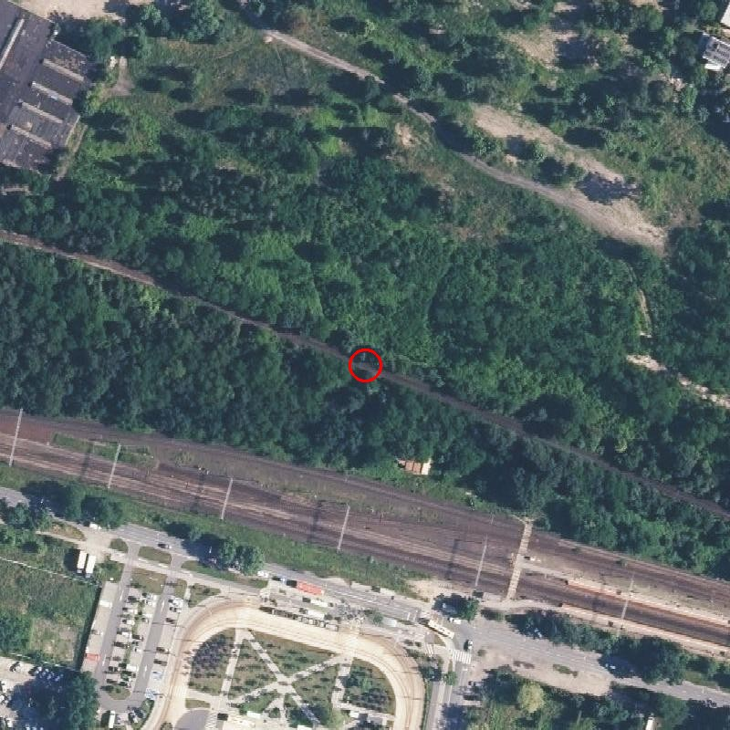

# 9. Żernicka - linia 751 (T1-0044)

**Wynik ryzyka: 55,9 / 100** (miejsce 9 z 20; punkt T1-0044 ma pozycję 11 z 82 kandydatów)

- Położenie: najbliższa ulica Żernicka (93 m), stacja Wrocław Nowy Dwór (217 m), linia 751. Współrzędne 51.12076, 16.95260.
- Geoportal (ortofotomapa): https://mapy.geoportal.gov.pl/imap/Imgp_2.html?gpmap=gp0&bbox=356608,363397,356908,363697&variant=ORTOFOTOMAPA
- Ortofoto 300 x 300 m (czerwone kółko = kandydat): 

## Trzy czynniki

| czynnik | wartość 0-1 | co to znaczy |
|---|---|---|
| Ekspozycja (ilu ludzi ma powód przejść) | 1,00 | 5 278 mieszkańców w 500 m (strona A: 3 845, strona B: 1 432). Cele po stronie A: przystanek lub stacja, sklepy, zakłady pracy, biura, park, obiekty sportowe, zabudowa mieszkaniowa. Cele po stronie B: przystanek lub stacja, szkoła lub przedszkole, sklepy, zakłady pracy, biura, ogródki działkowe, park, obiekty sportowe, zabudowa mieszkaniowa. |
| Objazd (brak legalnej drogi) | 0,50 | legalna droga 1,1 km zamiast 120 m na skróty (objazd 1,0 km, 9,4 razy dłużej); najbliższe legalne przejście: wiadukt, tunel lub kładka. |
| Zagrożenie (pociągi, prędkość, tory) | 0,35 | 0 pociągów pasażerskich na dobę (środa 18.11.2026, wszystkie linie w 30 m), prędkość maks. 60 km/h, torów do przejścia: 6. |

## Uwagi

- stacja lub grupa torów (5+ torów); czynnik objazdu ograniczony do 0,5, bo objazd liczony przez cały węzeł jest mniej pewny
- w promieniu 30 m tylko linie bez pociągów pasażerskich; ruch towarowy nieznany (brak publicznych danych), więc zagrożenie jest zaniżone
- miejsce oznaczone przez społeczność OSM jako nielegalne przejście (hazard=illegal_crossing)

## Zalecana interwencja

- Etap 0 (od zaraz): patrol SOK 18-23 + pomiar ruchu przed/po. Patrol zostaje do czasu wykonania rozwiązania głównego.
- Główna: **Przełożenie dojścia do peronu (koniec jednostronnego dojścia) + wygrodzenie końców peronu** - 82 000-1 500 000 zł/dojście.
- Wspierająca: Maty/panele antywtargnięciowe - koszt nieustalony (brak publicznej ceny).
- Zawsze dodatkowo: tablice z informacją o mandacie (600-4 000 zł) (reguła R0).
- Reguła doboru: R7. Kandydat 105 m od peronu (próg: 150 m).

Stabilność: miejsce zostaje w top-20 w 93% wariantów jednej zmiany (+-50%) i w 84% z 2000 losowań wszystkich wag naraz.

Źródła: kandydat OSM (hazard_tag;shared_node); ruch i prędkość PKP PLK (Regulamin sieci 2025/2026, zał. 2.1; rozkład PolishTrainsGTFS); ludność GUS NSP 2021 (siatka 250 m); cele i sieć piesza OpenStreetMap; ortofoto Geoportal (GUGiK). Ortofoto: pobrane z Geoportalu (WMS ORTO, StandardResolution).
