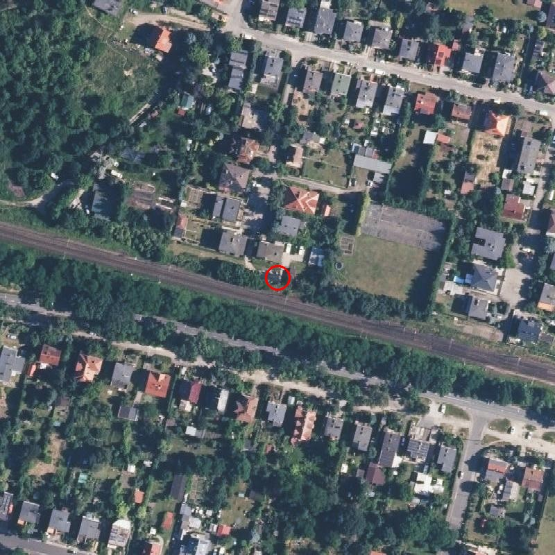

# 13. Słupska - linia 275 (T1-0042)

**Wynik ryzyka: 53,1 / 100** (miejsce 13 z 20; punkt T1-0042 ma pozycję 18 z 82 kandydatów)

- Położenie: najbliższa ulica Słupska (18 m), stacja Wrocław Nowy Dwór (911 m), linia 275. Współrzędne 51.12190, 16.94265.
- To samo miejsce (w promieniu 300 m): T1-0040, T1-0041.
- Geoportal (ortofotomapa): https://mapy.geoportal.gov.pl/imap/Imgp_2.html?gpmap=gp0&bbox=355915,363543,356215,363843&variant=ORTOFOTOMAPA
- Ortofoto 300 x 300 m (czerwone kółko = kandydat): 

## Trzy czynniki

| czynnik | wartość 0-1 | co to znaczy |
|---|---|---|
| Ekspozycja (ilu ludzi ma powód przejść) | 0,66 | 2 036 mieszkańców w 500 m (strona A: 804, strona B: 1 232). Cele po stronie A: przystanek lub stacja, sklepy, zakłady pracy, biura, ogródki działkowe, obiekty sportowe, zabudowa mieszkaniowa. Cele po stronie B: przystanek lub stacja, szkoła lub przedszkole, zakłady pracy, biura, ogródki działkowe, park, obiekty sportowe, zabudowa mieszkaniowa. |
| Objazd (brak legalnej drogi) | 0,27 | legalna droga 534 m zamiast 60 m na skróty (objazd 474 m, 8,9 razy dłużej); najbliższe legalne przejście: wiadukt, tunel lub kładka. |
| Zagrożenie (pociągi, prędkość, tory) | 0,85 | 94 pociągów pasażerskich na dobę (środa 18.11.2026, wszystkie linie w 30 m), prędkość maks. 160 km/h, torów do przejścia: 2. |

## Uwagi

- inne dzikie przejścia w promieniu 300 m: po zamknięciu jednego ruch może się przesunąć

## Zalecana interwencja

- Etap 0 (od zaraz): patrol SOK 18-23 + pomiar ruchu przed/po. Patrol zostaje do czasu wykonania rozwiązania głównego.
- Główna: **Legalne przejście kat. E z labiryntem/barierkami** - 14 000-1 500 000 zł/przejście.
- Wspierająca: Ogrodzenie standardowe odcinka (siatka/panel 1,5-2 m) - 26 000-134 000 zł (założenie: 2 x 100 m ogrodzenia kanalizującego (Clapperton: min. 100 m)).
- Zawsze dodatkowo: tablice z informacją o mandacie (600-4 000 zł) (reguła R0).
- Reguła doboru: R2. Najtańsze rozwiązanie trwałe dopuszczalne prawnie: <= 3 tory i prędkość <= 160 km/h (§ 5, § 11). Warunek: widoczność pociągu L2 = 3 x Vr = 480 m z 4 m od skrajnej szyny (Dz.U. 2025 poz. 1105, zał. 3 cz. C) - do sprawdzenia w terenie; bez widoczności potrzebny system przejazdowy albo ograniczenie prędkości. Oświetlenie przejścia (8 000-15 500 zł/punkt) tylko jako uzupełnienie - samo nie ma zmierzonego efektu.

Stabilność: miejsce zostaje w top-20 w 97% wariantów jednej zmiany (+-50%) i w 89% z 2000 losowań wszystkich wag naraz.

Źródła: kandydat OSM (informal_tag); ruch i prędkość PKP PLK (Regulamin sieci 2025/2026, zał. 2.1; rozkład PolishTrainsGTFS); ludność GUS NSP 2021 (siatka 250 m); cele i sieć piesza OpenStreetMap; ortofoto Geoportal (GUGiK). Ortofoto: pobrane z Geoportalu (WMS ORTO, StandardResolution).
