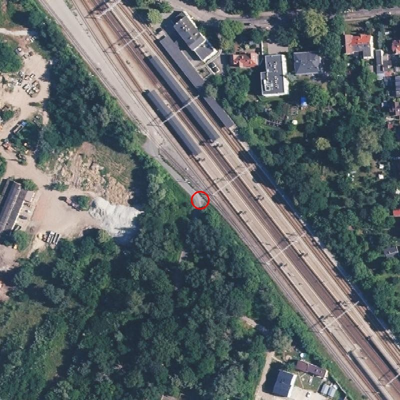

# 16. Wojska Polskiego - linia 275 (T1-0026)

**Wynik ryzyka: 48,5 / 100** (miejsce 16 z 20; punkt T1-0026 ma pozycję 22 z 82 kandydatów)

- Położenie: najbliższa ulica Wojska Polskiego (0 m), stacja Wrocław Leśnica (43 m), linia 275. Współrzędne 51.14189, 16.86667.
- Geoportal (ortofotomapa): https://mapy.geoportal.gov.pl/imap/Imgp_2.html?gpmap=gp0&bbox=350664,365917,350964,366217&variant=ORTOFOTOMAPA
- Ortofoto 300 x 300 m (czerwone kółko = kandydat): 

## Trzy czynniki

| czynnik | wartość 0-1 | co to znaczy |
|---|---|---|
| Ekspozycja (ilu ludzi ma powód przejść) | 0,42 | 1 560 mieszkańców w 500 m (strona A: 132, strona B: 1 429). Cele po stronie A: przystanek lub stacja, zakłady pracy, biura, zabudowa mieszkaniowa. Cele po stronie B: przystanek lub stacja, szkoła lub przedszkole, sklepy, zakłady pracy, biura, ogródki działkowe, park, obiekty sportowe, zabudowa mieszkaniowa. |
| Objazd (brak legalnej drogi) | 0,29 | legalna droga 603 m zamiast 90 m na skróty (objazd 513 m, 6,7 razy dłużej); najbliższe legalne przejście: wiadukt, tunel lub kładka. |
| Zagrożenie (pociągi, prędkość, tory) | 0,92 | 94 pociągów pasażerskich na dobę (środa 18.11.2026, wszystkie linie w 30 m), prędkość maks. 160 km/h, torów do przejścia: 7. |

## Uwagi

- stacja lub grupa torów (5+ torów); czynnik objazdu ograniczony do 0,5, bo objazd liczony przez cały węzeł jest mniej pewny

## Zalecana interwencja

- Etap 0 (od zaraz): patrol SOK 18-23 + pomiar ruchu przed/po. Patrol zostaje do czasu wykonania rozwiązania głównego.
- Główna: **Przełożenie dojścia do peronu (koniec jednostronnego dojścia) + wygrodzenie końców peronu** - 82 000-1 500 000 zł/dojście.
- Wspierająca: Maty/panele antywtargnięciowe - koszt nieustalony (brak publicznej ceny).
- Zawsze dodatkowo: tablice z informacją o mandacie (600-4 000 zł) (reguła R0).
- Reguła doboru: R7. Kandydat 16 m od peronu (próg: 150 m).

Stabilność: miejsce zostaje w top-20 w 93% wariantów jednej zmiany (+-50%) i w 64% z 2000 losowań wszystkich wag naraz.

Źródła: kandydat OSM (informal_tag); ruch i prędkość PKP PLK (Regulamin sieci 2025/2026, zał. 2.1; rozkład PolishTrainsGTFS); ludność GUS NSP 2021 (siatka 250 m); cele i sieć piesza OpenStreetMap; ortofoto Geoportal (GUGiK). Ortofoto: pobrane z Geoportalu (WMS ORTO, StandardResolution).
